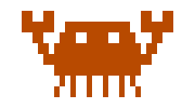
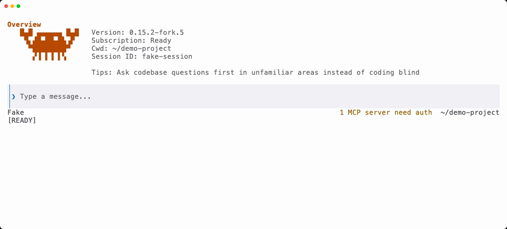
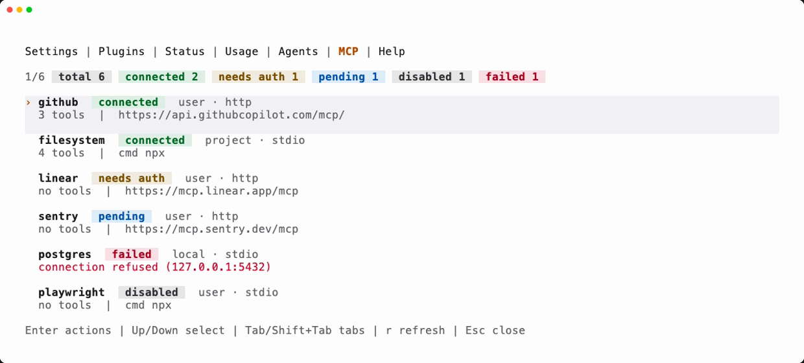

<p align="center">
  <picture>
    <source media="(prefers-color-scheme: dark)" srcset="assets/mascot-dark.svg">
    
  </picture>
</p>

<h1 align="center">Claude Code Rust</h1>

<p align="center">
  A native Rust terminal interface for Claude Code.<br>
  Ayush's fork of <a href="https://github.com/srothgan/claude-code-rust">srothgan/claude-code-rust</a>.
</p>

<p align="center">
  <a href="https://github.com/ayush5harma/claude-code-rust/releases/latest"></a>
  <a href="https://github.com/ayush5harma/claude-code-rust/actions/workflows/pr.yml"></a>
  <a href="https://srothgan.github.io/claude-code-rust/"></a>
  <a href="https://www.apache.org/licenses/LICENSE-2.0"></a>
</p>

> [!NOTE]
> **This is a fork.** The original project is [Claude Code Rust by Simon Rothgang](https://github.com/srothgan/claude-code-rust). This fork keeps the upstream architecture, follows upstream releases, and adds the changes listed under [What this fork adds](#what-this-fork-adds). Fork releases come from [this repository's releases](https://github.com/ayush5harma/claude-code-rust/releases); `npm install -g claude-code-rust` and the upstream install scripts install the upstream build, not this fork. Report fork-specific problems [here](https://github.com/ayush5harma/claude-code-rust/issues) and upstream problems [upstream](https://github.com/srothgan/claude-code-rust/issues).

## Screenshots

<p align="center">
  <picture>
    <source media="(prefers-color-scheme: dark)" srcset="assets/screenshot-dark-welcome.png">
    
  </picture>
</p>

<p align="center">
  <picture>
    <source media="(prefers-color-scheme: dark)" srcset="assets/screenshot-dark-mcp.png">
    
  </picture>
</p>

<p align="center"><sub>GitHub shows the dark or the light pictures to match your own theme. They are made with demo data by <code>recordings/showcase.sh</code>.</sub></p>

## What it is

Claude Code Rust replaces the stock Claude Code terminal interface with a native Rust binary built on [Ratatui](https://ratatui.rs/). It talks to Claude through a local bridge to Anthropic's public [Agent SDK](https://docs.anthropic.com/en/docs/agents-and-tools/claude-code/agent-sdk). The SDK owns session behavior; the Rust application owns everything you see. Tool calls, file edits, terminal commands and permissions work as they do in Claude Code, with your existing Claude account.

The stock interface runs on Node.js with React Ink, which redraws whole frames over raw ANSI escape codes. Users widely report flicker, high idle CPU, a 200-400 MB memory baseline, garbled resizes, input lag as context grows, lost scrollback and freezes on large pastes. Claude Code Rust draws with diffed, direct terminal control through Crossterm and Ratatui, with no full-frame redraws and no React render loop. These improvements come from daily use, not from a benchmark against the stock interface; none exists yet.

## What this fork adds

The additions below are measured against upstream commit `26f9b12` (v0.15.2); ordinary upstream features are not listed. The [changelog](CHANGELOG.md) has the details of each release.

### v0.15.2-fork.6

| Change | What it does |
| --- | --- |
| Accessible palette ([#36](https://github.com/ayush5harma/claude-code-rust/issues/36)) | One semantic palette after Apple's [Human Interface Guidelines](https://developer.apple.com/design/human-interface-guidelines/color) replaces named ANSI colors, which terminal themes remap. Every text color reaches 4.5:1 contrast against the terminal background and the app's own fills, and tests enforce it. Status badges are tinted, with Apple's meanings for green, yellow, blue, gray and red. |
| Light and dark appearance | The palette, code blocks and file previews follow the terminal's appearance. See [Appearance](#appearance). |
| New crab | The welcome crab is pixel art drawn in block elements. It looks around and scuttles while connecting, and snaps its claws once when it connects. |
| Dependencies | Agent SDK 0.3.300, Rust 1.98 toolchain, refreshed Cargo and npm lockfiles. |

### v0.15.2-fork.5

- **Responsive footer and agent shelf.** The footer adapts to the terminal width and keeps session facts in one place. While Claude delegates, a bounded shelf shows each agent's model, activity, usage and elapsed time.
- **Agent inspector.** Ctrl+T selects an agent, and Enter opens its model choice, recent tools, prompt and saved messages.

### v0.15.2-fork.4

| Change | What it does |
| --- | --- |
| Upstream sync ([#28](https://github.com/ayush5harma/claude-code-rust/pull/28)) | Upstream main at `a187e1c`, including upstream [#444](https://github.com/srothgan/claude-code-rust/pull/444). |
| Slash ranking and trust prompt ([#29](https://github.com/ayush5harma/claude-code-rust/pull/29)) | Prefix matches rank before substring matches, and the trust prompt names the directory. |
| Welcome animation ([#30](https://github.com/ayush5harma/claude-code-rust/pull/30)) | The crab animates while connecting, greets once, then rests. Nothing moves at idle, and `prefersReducedMotion` keeps it still. |
| `/export` naming ([#31](https://github.com/ayush5harma/claude-code-rust/pull/31)) | Default names `export-<session-id>-<UTC>.md`, with `-2`, `-3` suffixes on collision. |
| Command-line surface ([#32](https://github.com/ayush5harma/claude-code-rust/pull/32)) | Refuses to start without a terminal (exit 25), checks `--dir` and `--bridge-script` early, scopes session flags to interactive launches, guards subcommand typos and documents exit status. |

### v0.15.2-fork.3

| Change | What it does |
| --- | --- |
| Launch and session flags ([#11](https://github.com/ayush5harma/claude-code-rust/pull/11)) | `--name`, `--fork-session`, repeatable `--add-dir`, file or inline `--settings` and `--mcp-config`, `--strict-mcp-config`, and replacement or appended system prompts from text or files. |
| Hook visibility ([#12](https://github.com/ayush5harma/claude-code-rust/pull/12)) | Progress and completion notices, per-hook duration, slow-hook summaries and startup milestones in Status. Hook output is sanitized and redacted before it is kept. |
| `/reload` and `/export` ([#13](https://github.com/ayush5harma/claude-code-rust/pull/13)) | Reload skills without restarting the session; export saved history as Markdown without overwriting a file. |
| Native `/diff` ([#15](https://github.com/ayush5harma/claude-code-rust/pull/15)) | Working-tree changes, including untracked files and repositories without a first commit, beside the session's tool diffs. |
| `/agents` panel ([#18](https://github.com/ayush5harma/claude-code-rust/pull/18)) | SDK subagent history and current task state; only a matching running task can be stopped. |
| Transcript search ([#19](https://github.com/ayush5harma/claude-code-rust/pull/19)) | `/search` and Ctrl+F over kept user, assistant and visible tool text, with Unicode-aware matching. |
| Session management ([#21](https://github.com/ayush5harma/claude-code-rust/pull/21), [#22](https://github.com/ayush5harma/claude-code-rust/pull/22)) | Tags and confirmed deletion in the picker, exact-title resume with ambiguity reporting, session sizes and a compact-first option for large sessions. |
| Session accents ([#23](https://github.com/ayush5harma/claude-code-rust/pull/23)) | A stable color per session; `/color` applies only after the SDK confirms it. |
| Input ergonomics ([#24](https://github.com/ayush5harma/claude-code-rust/pull/24)) | Backslash-Enter newline, Ctrl+G external editor, Esc Esc rewind, Ctrl+D and `/exit`, Ctrl+O transcript detail, Ctrl+T tasks, remappable shortcuts and paste-safe input. |
| Composer and footer ([#25](https://github.com/ayush5harma/claude-code-rust/pull/25)) | `filled` or `rules` composer, a footer with context, session, rate windows, agents and permissions, the latest plan, and a user-level `statusLine` command. |
| Session fixes ([#16](https://github.com/ayush5harma/claude-code-rust/pull/16)) | Symlinked settings are read but never written through; model, mode and effort survive rewind; SDK titles are restored while explicit launch names win. |
| Tooling ([#7](https://github.com/ayush5harma/claude-code-rust/pull/7)-[#10](https://github.com/ayush5harma/claude-code-rust/pull/10), [#17](https://github.com/ayush5harma/claude-code-rust/pull/17)) | Portable bridge test discovery, a local check runner and Nix shell, a live end-to-end harness, a render corpus with revision-to-revision benchmarks, and CI that compares against the pull request's recorded base. |

### v0.15.2-fork.2

- **SDK local-command replies.** Replies to `/rename`, `/color`, `/context` and `/usage` appear in the transcript even when the SDK does not stream them, and streamed replies are not printed twice (upstream [#444](https://github.com/srothgan/claude-code-rust/pull/444)).
- **Live session names.** Status, the rename dialog and title generation use the SDK's current session title (upstream [#445](https://github.com/srothgan/claude-code-rust/pull/445)).
- **Fork releases.** GitHub releases carry platform archives, a release bundle and SHA-256 checksums under fork version numbers, without publishing to the upstream npm package.

### Not yet available

A stock-style memory-file picker, a native remote-control start/stop/share flow, shell input mode, Vim keymaps and general MCP resource attachments wait on operations the public Agent SDK does not expose yet. `/memory` opens the Memory settings instead.

## Install

Install the [Claude Code CLI](https://docs.anthropic.com/en/docs/claude-code) first and keep `claude` on `PATH`; some features still go through it ([details](https://srothgan.github.io/claude-code-rust/about.html#claude-cli-dependencies)).

### This fork

Download the archive for your platform from [this fork's latest release](https://github.com/ayush5harma/claude-code-rust/releases/latest) and check it against the release's `SHA256SUMS`. Keep the extracted layout whole: it includes the bridge and its runtime.

To run unreleased changes, clone `https://github.com/ayush5harma/claude-code-rust.git` and follow [CONTRIBUTING.md](CONTRIBUTING.md).

### Upstream

These install Simon Rothgang's distribution, not this fork:

```bash
# macOS and Linux
curl -fsSL https://raw.githubusercontent.com/srothgan/claude-code-rust/main/scripts/install/install.sh | sh
```

```powershell
# Windows PowerShell
powershell -NoProfile -ExecutionPolicy Bypass -Command "irm 'https://raw.githubusercontent.com/srothgan/claude-code-rust/main/scripts/install/install.ps1' | iex"
```

```bash
# Node.js 24+
npm install -g claude-code-rust
```

The [installation guide](https://srothgan.github.io/claude-code-rust/installation.html) covers pinning, install locations, switching methods, uninstalling and troubleshooting.

## Usage

```bash
claude-rs
claude-rs --model opus --permission-mode plan "Review this project"
claude-rs --continue
```

[Usage](https://srothgan.github.io/claude-code-rust/usage.html) lists the startup flags, shell completions and man pages.

> **Agent SDK billing is unchanged.** Anthropic has paused the previously announced Agent SDK credit change. Agent SDK usage, including `claude -p` and third-party apps like this one, still draws from your normal Claude subscription limits. See [Use the Claude Agent SDK with your Claude plan](https://support.claude.com/en/articles/15036540-use-the-claude-agent-sdk-with-your-claude-plan).

## Appearance

The palette has a dark and a light variant. At startup, claude-rs picks one in this order:

1. `CLAUDE_RS_APPEARANCE=light` or `dark`, if set.
2. The background color the terminal reports (an OSC 11 query, answered by Ghostty, iTerm2, kitty, WezTerm, Terminal.app and most others).
3. Claude Code's own `theme` setting, if the terminal does not answer and the theme is a light or dark one (`light`, `dark-daltonized` and so on).
4. Dark.

The colors are Apple's system colors from the [Human Interface Guidelines](https://developer.apple.com/design/human-interface-guidelines/color). Where the default variant fell short of the contrast floor, the increased-contrast variant is used. Body text uses the terminal's own foreground color. States carry a label or an icon as well as a color, so nothing depends on telling hues apart. Set `prefersReducedMotion` in Claude Code to keep the crab still.

## Documentation

The [upstream manual](https://srothgan.github.io/claude-code-rust/) covers [installation](https://srothgan.github.io/claude-code-rust/installation.html), [usage](https://srothgan.github.io/claude-code-rust/usage.html), [help](https://srothgan.github.io/claude-code-rust/help.html), [slash commands](https://srothgan.github.io/claude-code-rust/commands.html), [settings](https://srothgan.github.io/claude-code-rust/settings.html), [troubleshooting](https://srothgan.github.io/claude-code-rust/troubleshooting.html) and [development](https://srothgan.github.io/claude-code-rust/development.html). Fork additions are documented here and in the [changelog](CHANGELOG.md).

For the design history, including the move from fullscreen to inline rendering in 0.12.0, see Simon Rothgang's [I rebuilt Claude Code's terminal UI in Rust. Then I deleted 12,000 lines of it.](https://medium.com/@simonrothgang/i-rebuilt-claude-codes-terminal-ui-in-rust-then-i-deleted-12-000-lines-of-it-e8593a200452)

## Development

[CONTRIBUTING.md](CONTRIBUTING.md) has the build, test and verification commands. To refresh the screenshots above after a UI change, run `recordings/showcase.sh`. It needs [VHS](https://github.com/charmbracelet/vhs) and Node.js, and it drives the app with the test suite's fake bridge, so no login is needed.

## Status and limitations

The project is pre-1.0 and under active development. It follows new Agent SDK releases and problems found in daily use, and has no fixed roadmap or 1.0 date.

Startup is bounded by the Agent SDK runtime that the interface wraps. The Rust interface is fast, but a session can still take noticeable time to become available.

## License

[Apache License 2.0](LICENSE), as upstream.

## Disclaimer and legal notice

This project is not affiliated with, endorsed by, or supported by Anthropic.

The original author's clarification applies to this fork: claude-code-rust is a terminal UI written from scratch in Rust. It is not a fork, copy or port of the latest Claude Code source leak. It talks to Anthropic's official [Agent SDK](https://docs.anthropic.com/en/docs/agents-and-tools/claude-code/agent-sdk) as a runtime dependency instead, the same way any other third-party tool would. No Anthropic source code was read or used as reference at any point during development.

The project authenticates through your existing Claude Code account via the Agent SDK, and the Agent SDK's terms allow building on top of it. Billing, credits, limits, and overage behavior are controlled by Anthropic, including any future changes Anthropic may make to how Agent SDK usage is metered. Other community projects do the same. As far as I can tell, using this project is fine, but I am a single maintainer, not a lawyer. If anything changes on Anthropic's end, I will update this section and adjust the project accordingly.

This project's source code is licensed under [Apache-2.0](LICENSE). The Agent SDK itself is proprietary and governed by [Anthropic's Commercial Terms of Service](https://www.anthropic.com/legal/commercial-terms).

For official Claude documentation, see [https://claude.ai/docs](https://claude.ai/docs).
