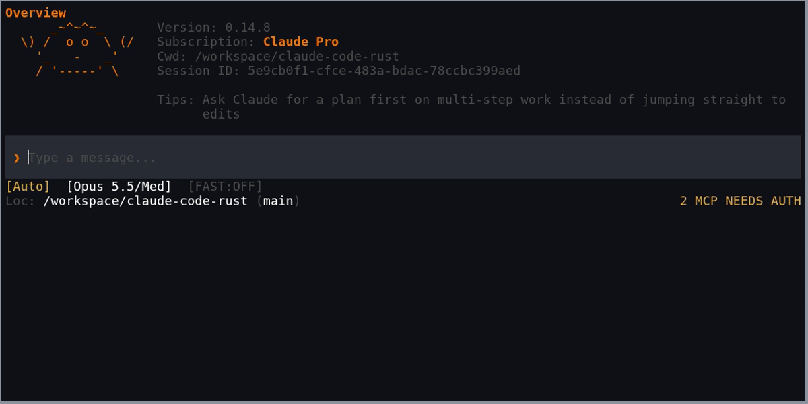

# Claude Code Rust — Ayush's fork

A native Rust terminal interface for Claude Code. Drop-in replacement for Anthropic's stock Node.js/React Ink TUI, built for performance and a better user experience.

[](https://github.com/ayush5harma/claude-code-rust/releases/latest)
[](https://github.com/ayush5harma/claude-code-rust/actions/workflows/pr.yml)
[](https://srothgan.github.io/claude-code-rust/)
[](https://www.apache.org/licenses/LICENSE-2.0)

## What this fork adds

This is [Ayush's fork](https://github.com/ayush5harma/claude-code-rust) of [Simon Rothgang's Claude Code Rust](https://github.com/srothgan/claude-code-rust). It keeps the upstream architecture: the public Claude Agent SDK owns session behavior and the Rust application owns terminal presentation. The additions below are relative to upstream commit `26f9b12` (v0.15.2); ordinary upstream features are not fork additions.

### Released in v0.15.2-fork.2

| Change | Behavior |
| --- | --- |
| SDK local-command replies | Completed SDK replies such as `/rename`, `/color`, `/context`, and `/usage` appear in the transcript even when the SDK does not stream them. Streamed replies are not printed twice. This includes displaying `/color` replies, not applying a session accent color to the Rust UI. |
| Live session names | The Status tab, rename dialog, and title-generation flow use the SDK's current session title. Names refresh when connecting, resuming, replacing or resetting a session, after turns, and after renaming. |
| Fork release artifacts | GitHub releases publish platform archives, a release bundle, and SHA-256 checksums under fork version numbers, without publishing to the upstream npm package. |

The two SDK behavior fixes incorporate upstream pull requests [#444](https://github.com/srothgan/claude-code-rust/pull/444) and [#445](https://github.com/srothgan/claude-code-rust/pull/445). See the [fork changelog](CHANGELOG.md) and [v0.15.2-fork.2 release](https://github.com/ayush5harma/claude-code-rust/releases/tag/v0.15.2-fork.2).

### Added in v0.15.2-fork.3

| Change | What it adds |
| --- | --- |
| Bridge test discovery and fixtures ([#7](https://github.com/ayush5harma/claude-code-rust/pull/7)) | Portable test discovery and a corrected TypeScript fixture loader so local and CI checks exercise the intended bridge tests. |
| Local CI runner and development shell ([#8](https://github.com/ayush5harma/claude-code-rust/pull/8)) | A single local check runner and a Nix development shell for the repository's Rust, bridge, and repository checks. |
| Live end-to-end harness ([#10](https://github.com/ayush5harma/claude-code-rust/pull/10)) | Repeatable real-SDK terminal scenarios with recorded pass, failure, gap, and skip outcomes. Reports distinguish verified behavior from SDK gaps and skipped scenarios; the original baseline remains documented for comparison. |
| Render corpus and benchmark comparison ([#9](https://github.com/ayush5harma/claude-code-rust/pull/9)) | Representative rendering workloads and repeated baseline/candidate measurements, with noise checks, invalid-result rejection, and temporary-worktree cleanup on interruption. These compare revisions of this application; they are not a benchmark against Anthropic's stock interface. |
| Launch and session flags ([#11](https://github.com/ayush5harma/claude-code-rust/pull/11)) | `--name`, `--fork-session`, repeatable `--add-dir`, file or inline `--settings` and `--mcp-config`, `--strict-mcp-config`, and replacement/appended system prompts from text or files. Session names and forks apply to the initial session; directory and configuration overrides persist for sessions started within the process. |
| Skill reload and conversation export ([#13](https://github.com/ayush5harma/claude-code-rust/pull/13)) | `/reload` refreshes available skills and completion without restarting the session. `/export` writes saved conversation history as Markdown and refuses to overwrite an existing file. |
| Session regression fixes ([#16](https://github.com/ayush5harma/claude-code-rust/pull/16)) | Read symlinked settings without allowing writes through them, preserve active model/mode/effort and process configuration across rewind, and restore SDK session titles while honoring explicit launch names. Resumed command-like text stays verbatim because the SDK does not expose reliable provenance. |
| Stable CI change comparison ([#17](https://github.com/ayush5harma/claude-code-rust/pull/17)) | Compare changes against the pull request's recorded base commit so parallel merges do not break checks with a missing merge base. |
| Hook visibility ([#12](https://github.com/ayush5harma/claude-code-rust/pull/12)) | Progress and completion notices, per-hook duration, slow-hook summaries, and measured startup milestones in Status. Hook output is sanitized and redacted before retention. |
| Native `/diff` viewer ([#15](https://github.com/ayush5harma/claude-code-rust/pull/15)) | Working-tree changes, including untracked files and repositories without a first commit, alongside retained current-session tool diffs. |
| Session `/agents` panel ([#18](https://github.com/ayush5harma/claude-code-rust/pull/18)) | Public SDK subagent history and current-session task state, with stopping restricted to a matching currently running task. |
| Retained transcript search ([#19](https://github.com/ayush5harma/claude-code-rust/pull/19)) | `/search [query]` and remappable Ctrl+F search retained user, assistant, and visible tool text, with Unicode-aware matching. Archived history and hidden tool inputs are excluded. |
| Session tags and deletion ([#21](https://github.com/ayush5harma/claude-code-rust/pull/21)) | SDK-backed picker actions, confirmation before deletion, and protection for the active session. |
| Resume ergonomics ([#22](https://github.com/ayush5harma/claude-code-rust/pull/22)) | Exact-title resolution with ambiguity reporting, session sizes in bytes, and an explicit compact-first option for large sessions. |
| Session accents ([#23](https://github.com/ayush5harma/claude-code-rust/pull/23)) | Stable session-ID colors, with `/color` changes applied only after a correlated successful SDK confirmation. |
| Input ergonomics ([#24](https://github.com/ayush5harma/claude-code-rust/pull/24)) | Backslash-Enter newline, Ctrl+G with VISUAL or EDITOR, Esc Esc rewind, empty Ctrl+D and `/exit`, Ctrl+O retained-transcript detail view, Ctrl+T tasks, remappable shortcuts, and paste-safe input handling. |
| Composer and footer ([#25](https://github.com/ayush5harma/claude-code-rust/pull/25)) | Configurable `filled` or `rules` composer style; session-accent rules and prompt glyph; dynamic footer with context, session name, available SDK rate information, current-session agent counts, and permissions; the latest confirmed Task or TodoWrite plan; and a user-level configured `statusLine` command. Project and local settings cannot select an executable command; the user command receives documented JSON on stdin after the SDK session connects. Unavailable SDK rate and token fields are omitted rather than estimated. |

See [CONTRIBUTING.md](CONTRIBUTING.md) for the development commands and verification requirements.

### Remaining verification

Fresh live verification remains. The native `/memory` flow opens Memory settings; a stock-style memory-file picker/editor is unavailable because the pinned public host SDK has no picker or editor operation. Remote control startup can be configured, but a native start/stop/share-link flow is unavailable through the pinned public host API. Shell input and Vim keymap parity remain unimplemented. Generic MCP resource attachments are conditional on public SDK support: the pinned resource-reading API supports MCP Apps `ui://` resources, not general resource discovery and reading.

## About

Claude Code Rust replaces the stock Claude Code terminal interface with a native Rust binary built on [Ratatui](https://ratatui.rs/). It connects to the same Claude API through a local Agent SDK bridge. Core Claude Code functionality works unchanged, including tool calls, file editing, terminal commands, and permissions.

<p align="center">
  
</p>

## Prerequisite

Install the Claude Code CLI and keep `claude` on `PATH` for some functionality not yet supported by the Anthropic SDK. See the [dependency and feature overview](https://srothgan.github.io/claude-code-rust/about.html#claude-cli-dependencies) for details.

## Install

### This fork

Download the archive for your operating system and architecture from [this fork's releases](https://github.com/ayush5harma/claude-code-rust/releases/latest), and verify it against the release's `SHA256SUMS`. Keep the complete extracted layout, including the bundled bridge and runtime. Fork releases are distributed through GitHub; `npm install -g claude-code-rust` installs the upstream package.

To build unreleased changes, clone `https://github.com/ayush5harma/claude-code-rust.git` and follow [CONTRIBUTING.md](CONTRIBUTING.md). Check the branch and release before assuming a feature listed above is installed.

### Upstream install script (v0.14.0+)

The following upstream installation methods install Simon Rothgang's distribution, not this fork.

**macOS/Linux:**

```bash
curl -fsSL https://raw.githubusercontent.com/srothgan/claude-code-rust/main/scripts/install/install.sh | sh
```

**Windows PowerShell:**

```powershell
powershell -NoProfile -ExecutionPolicy Bypass -Command "irm 'https://raw.githubusercontent.com/srothgan/claude-code-rust/main/scripts/install/install.ps1' | iex"
```

<details>
<summary><b>Already have Node.js 24+? Use npm instead</b></summary>

```bash
npm install -g claude-code-rust
```

<sub>The package ships prebuilt platform binaries and its own Bun runtime for the Agent SDK bridge, so no Rust toolchain, Bun install, or `postinstall` script is needed. Node.js 24+ is still required to run the `claude-rs` launcher.</sub>

</details>

See the [installation guide](https://srothgan.github.io/claude-code-rust/installation.html) for release pinning, custom install locations, switching install methods, uninstall, and troubleshooting.

## Usage

```bash
claude-rs
claude-rs --model opus --permission-mode plan "Review this project"
claude-rs --continue
```

See [Usage](https://srothgan.github.io/claude-code-rust/usage.html) for startup flags, shell completion setup, and man pages.

The upstream manual is available at [srothgan.github.io/claude-code-rust](https://srothgan.github.io/claude-code-rust/).

> **Note — Agent SDK billing unchanged.** Anthropic has paused the previously announced Agent SDK credit change. For now nothing changes: Claude Agent SDK usage (including `claude -p` and third-party apps like this one) still draws from your normal Claude subscription limits. See [Use the Claude Agent SDK with your Claude plan](https://support.claude.com/en/articles/15036540-use-the-claude-agent-sdk-with-your-claude-plan).

## Why

The stock Claude Code TUI runs on Node.js with React Ink, which renders by redrawing full frames over raw ANSI escape codes. Users widely report the following problems with it:

- **Flickering**: The whole view is redrawn on every status update, causing constant flicker (bad enough to crash editors' integrated terminals during long sessions)
- **CPU**: Sustained high CPU even when idle, and runaway loops that spawn multiple background processes
- **Memory**: 200-400MB baseline (and climbing with conversation length) vs ~20-50MB for a native binary
- **Resize**: Window resizing leaves duplicated frames in scrollback, loses lines when shrinking, and can garble the display
- **Input latency**: Keystrokes echo with visible delay as context fills up, and noticeably worse on Windows
- **Scrollback**: Hijacks the terminal's native scrollback, erasing history you can no longer scroll back to
- **Paste**: Large pastes can flood stdout and freeze the terminal

Claude Code Rust addresses these with a native terminal UI that uses diffed, direct terminal control via Crossterm and Ratatui, with no full-frame redraws and no React Ink rendering loop. There is no benchmark against the stock interface yet, so the improvements are based on daily use, not on measurements.

## Documentation

The manual covers installation with scripts and npm, plus help, slash commands, keyboard shortcuts, settings, diagnostics, troubleshooting, building from source, architecture, and the changelog:

- [Installation](https://srothgan.github.io/claude-code-rust/installation.html)
- [Usage](https://srothgan.github.io/claude-code-rust/usage.html)
- [Help](https://srothgan.github.io/claude-code-rust/help.html)
- [Slash commands](https://srothgan.github.io/claude-code-rust/commands.html)
- [Settings](https://srothgan.github.io/claude-code-rust/settings.html)
- [Troubleshooting](https://srothgan.github.io/claude-code-rust/troubleshooting.html)
- [Development](https://srothgan.github.io/claude-code-rust/development.html)

For the design history, including the move from fullscreen to inline rendering in 0.12.0, see [I rebuilt Claude Code's terminal UI in Rust. Then I deleted 12,000 lines of it.](https://medium.com/@simonrothgang/i-rebuilt-claude-codes-terminal-ui-in-rust-then-i-deleted-12-000-lines-of-it-e8593a200452)

## Status

This project is pre-1.0 and under active development. See [CONTRIBUTING.md](CONTRIBUTING.md) for how to get involved.

Development follows new Agent SDK releases and problems found in daily use. The weekly Dependency Monitor tracks SDK updates. There is no fixed feature roadmap or date for 1.0.

## Limitations

Startup is still constrained by the upstream Claude Agent SDK runtime that this TUI wraps. The Rust interface itself is fast, but end-to-end readiness can still take noticeable time before a session is fully available. Improving that remains an active area of work.

## License

This project is licensed under the [Apache License 2.0](LICENSE). Apache-2.0 was chosen to keep usage and redistribution straightforward for individual users, downstream packagers, and commercial adopters.

## Disclaimer and Legal Notice

This project is not affiliated with, endorsed by, or supported by Anthropic.

The original author's clarification applies to this fork: claude-code-rust is a terminal UI written from scratch in Rust. It is not a fork, copy or port of the latest Claude Code source leak. It talks to Anthropic's official [Agent SDK](https://docs.anthropic.com/en/docs/agents-and-tools/claude-code/agent-sdk) as a runtime dependency instead, the same way any other third-party tool would. No Anthropic source code was read or used as reference at any point during development.

The project authenticates through your existing Claude Code account via the Agent SDK, and the Agent SDK's terms allow building on top of it. Billing, credits, limits, and overage behavior are controlled by Anthropic, including any future changes Anthropic may make to how Agent SDK usage is metered. Other community projects do the same. As far as I can tell, using this project is fine, but I am a single maintainer, not a lawyer. If anything changes on Anthropic's end, I will update this section and adjust the project accordingly.

This project's source code is licensed under [Apache-2.0](LICENSE). The Agent SDK itself is proprietary and governed by [Anthropic's Commercial Terms of Service](https://www.anthropic.com/legal/commercial-terms).

For official Claude documentation, see [https://claude.ai/docs](https://claude.ai/docs).
